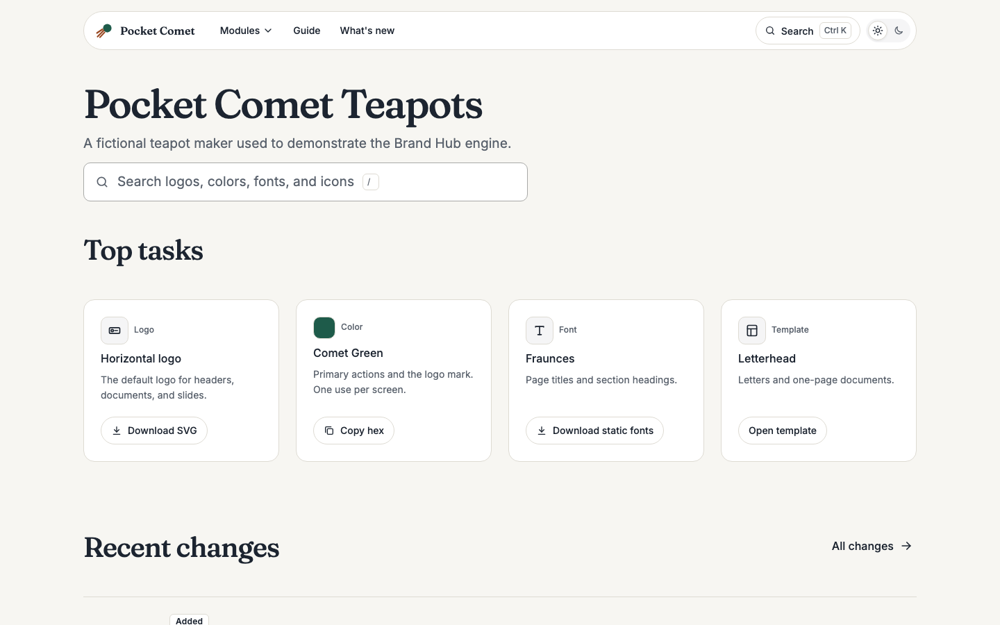

# Brand Hub

An engine for brand resource sites. It builds a static site of logos, colors, fonts, icons, photos, templates, and brand rules from a folder of brand data, plus an in-site editor for changing that data. One engine serves many brands. Each brand lives in its own instance repository and pins a tagged engine version.

The engine is an [Astro](https://astro.build) integration. Pages are static HTML. React is used only for interactive islands (search, icon detail, logo helper, signature generator, admin).

Status: 0.1.0. The public site covers home, search, logos, colors, fonts, icons, photos, templates, What's new, and rule pages under `/guide`. The editor at `/admin` edits, previews, saves, and publishes through adapters (`docs/ADAPTERS.md`). Start, signature, and boilerplate arrive in 0.3 and 0.4.



The screenshot shows `brands/demo`, a fictional teapot maker used for development, tests, and the public demo.

## Requirements

- Node.js 22.23.4 or later (the repo runs TypeScript scripts with Node's built-in type stripping)
- pnpm 12, through Corepack: `corepack enable` (or prefix commands with `corepack`, as in `corepack pnpm install`)

## Quick start

```sh
pnpm install
pnpm dev          # http://localhost:4321 with the demo brand; the editor is at /admin
```

## Commands

```sh
pnpm setup-hooks  # once after cloning: points git at .githooks (see "Commit hooks")
pnpm dev          # dev server with the demo brand
pnpm build        # static site in dist/
pnpm check        # schemas, brand data, copy standards, types
pnpm test         # unit tests (Vitest)
pnpm test:e2e     # end-to-end tests against dist/ (run pnpm build first)
pnpm test:local   # local adapter tests: astro dev on a temporary copy of the repo
```

`pnpm test:e2e` runs axe on every route in light and dark, checks for horizontal scroll at 320, 390, 768, and 1440 pixels and at 200% zoom, runs a keyboard-only task flow, and measures home page JavaScript against the 100 KB gzipped budget. It writes the size report to `test-results/js-size.json`. First run: `pnpm exec playwright install chromium`.

The repo runs as its own instance. `hub.config.ts` selects `brands/demo`, a fictional brand used for development, tests, and the public demo.

## How it works

```
hub.config.ts ──► integration ──► loader (schemas + integrity + contrast) ──► virtual:brand-hub ──► pages
                       │
                       └──► one injected route per enabled module, plus /, /guide/<id>, /admin,
                            /files/* (brand files), /downloads/*.zip, and /search-index.json
```

| Path | What it does |
|---|---|
| `src/integration/index.ts` | `brandHub()` Astro integration. Loads `hub.config.ts`, loads the brand, injects routes, serves `virtual:brand-hub` to pages. |
| `src/content/load.ts` | Reads `brands/<slug>/`, validates every file, checks ids, references, file paths, and contrast. Returns locked items for public pages and pending items for the "In progress" list. |
| `src/theme/` | Turns `brand.json` tokens into CSS custom properties for light and dark, and checks WCAG AA contrast. |
| `src/modules/` | One folder per module. `registry.ts` holds each module's route, label, and menu line. |
| `src/components/` | Layout, header, footer, and shared components (Button, Card, Tabs, Pills, Accordion, ChangelogEntry ...). |
| `src/islands/` | React islands: search dialog (loaded on first use), icon detail, Sheet. |
| `src/scripts/shell.ts` | The one script on every page: theme switch, menus, toasts, copy buttons, search shortcut. |
| `src/routes/` | Brand files, zip downloads, and the search index, built at build time. |
| `src/styles/global.css` | Base styles and component classes. Reads only tokens. |
| `schemas/` | zod schemas for every data file, and the generated JSON Schema files. |
| `brands/demo/` | Demo brand. |
| `scripts/` | `check-copy.mjs`, `check-shell-size.ts`, `validate-brands.ts`, `build-schemas.ts`, `setup-hooks.mjs`. |
| `tests/` | Vitest tests for the loader, theme pipeline, and integration. |

A module left out of `modules` in `hub.config.ts` gets no route. Navigation and search will follow the same list.

## Brand data

```
brands/<slug>/
  brand.json          name, short name, tokens, module settings
  assets.json         asset records, or split per module: logos.json, colors.json, fonts.json,
                      icons.json, templates.json, photos.json, boilerplate.json,
                      documents.json, signature.json
  rules.json          brand rules
  changelog.json      written by the editor on publish
  files/              logos, fonts, icons, thumbnails, documents
```

The build fails, with one line per problem (file, id, problem), when:

- a file does not match its schema, or a split file holds the wrong asset type
- two records share an id
- a `governedBy`, template `rules`, or color `pairings` id is not an existing rule or color, or a rule's `appliesTo` id is not an existing asset
- a file path does not exist under the brand folder
- a theme token pair or a declared color pairing is below WCAG 2.2 AA (4.5:1 text, 3:1 large text and graphics)

Only `locked` items reach public pages. `pending` items are returned separately. `draft` and `retired` items stay in the data.

Run `pnpm validate` to check brand data without building. After changing a zod schema, run `pnpm schemas` to regenerate `schemas/*.schema.json`. `pnpm check` fails while they are stale. `.vscode/settings.json` maps the JSON Schema files to brand files for autocomplete.

## Theme tokens

`brand.json` holds colors (light, optional dark), font families, radii, and the nine-step spacing scale. `src/theme/tokens.ts` writes them as CSS custom properties, with derived colors, the type scale per breakpoint, motion, and layout values. Names and values follow `docs/DESIGN_SYSTEM.md`. Components read only these properties, so a brand changes its look through tokens and never through component code.

## Using the engine in an instance

An instance is a separate, usually private, Astro project that holds one brand's data and its hosting setup.

1. Add the engine at a tagged version:

   ```sh
   pnpm add astro @astrojs/react react react-dom
   pnpm add github:yon-tyzes/brand-hub#v0.1.0
   ```

2. Register the integration in `astro.config.ts`:

   ```ts
   import { defineConfig } from "astro/config";
   import react from "@astrojs/react";
   import { brandHub } from "@yon-tyzes/brand-hub";

   export default defineConfig({ output: "static", integrations: [react(), brandHub()] });
   ```

3. Add `hub.config.ts` at the project root (fields in `docs/ENGINE_SPEC.md`, section 4):

   ```ts
   import { defineHub } from "@yon-tyzes/brand-hub";

   export default defineHub({ brand: "example", modules: ["logos", "colors", "fonts", "icons"] });
   ```

4. Add the brand folder at `brands/example/` and run `pnpm build`. Copying `brands/demo/` from this repo is a quick start; its icons and fonts keep the licenses in `THIRD_PARTY.md`.

The package ships TypeScript source with no build step on either side. Astro bundles packages that list `astro` as a peer dependency, so Vite compiles the engine while it builds the instance. The package exports:

| Import | What it is |
|---|---|
| `@yon-tyzes/brand-hub` | `brandHub()` integration and `defineHub()` |
| `@yon-tyzes/brand-hub/adapters` | `AuthAdapter`, `ContentAdapter`, `ChangeSet`, `Session`, and the `ConflictError` and `AdapterError` classes, for instance adapters |

The engine has no install scripts, because pnpm refuses git-hosted dependencies that run them without an allowlist entry.

## Editor

`/admin` is a React app for adding, editing, reordering, and retiring brand items without touching files. It is built when `admin.enabled` is true in `hub.config.ts`.

| Path | What it does |
|---|---|
| `src/admin/ui/` | The app: top bar, section rail, card grid, inspector, dialogs. |
| `src/admin/fields/` | Inspector fields per section: label, one line of help, and the control. Edit these to change what the editor asks for. |
| `src/admin/editor/` | No UI: state and undo history, the change set, validation messages, SVG cleaning, upload handling, autosave. |
| `src/adapters/` | `AuthAdapter` and `ContentAdapter` interfaces, and the built-in `local` and `demo` adapters. |
| `src/serializer/` | Turns the draft into validated, stable brand files and changelog lines. No UI, no network. |

How it works:

- Every edit is a pure function on the draft, kept in an undo history (Ctrl or Cmd+Z, Shift to redo). Typing in one field merges into one undo step.
- `toChangeSet()` turns the draft into the spec's `ChangeSet`: whole data files for each touched file, uploaded files, files nothing points to any more, and one summary line per change. Save runs it through the serializer, which names files, stamps dates and versions, and refuses to save while any item has a problem.
- The draft autosaves to IndexedDB and comes back after a reload if the brand has not changed. Without IndexedDB the editor works and says changes are not kept.
- Uploaded SVG files are cleaned in the browser: scripts, event handlers, embedded web content, and links to outside files are removed. Icons get `currentColor` and a viewBox. The editor lists what it changed.

Preview renders the public pages from the draft in a panel marked "Preview, not live". Save draft and Publish go through the adapters named in `hub.config.ts`. This repo uses `local` under `astro dev`, which writes `brands/demo/` on disk, and `demo` in builds, which keeps changes in memory. Do not publish `/admin` for a real brand with either: implement a server-backed adapter as described in `docs/ADAPTERS.md`.

## Checks and CI

`pnpm check` runs, in order:

1. `build-schemas.ts --check`: JSON Schema files match the zod sources.
2. `validate-brands.ts`: every brand under `brands/` passes the loader.
3. `check-copy.mjs`: copy and markup standards from `docs/STANDARDS.md` in `src`, `docs`, `brands`, and this README.
4. `check-shell-size.ts`: the shared shell script, which loads on every page, stays under 5 KB gzipped.
5. `astro check`: TypeScript and Astro diagnostics.

`.github/workflows/ci.yml` runs `pnpm check`, `pnpm test`, `pnpm build`, `pnpm test:e2e`, and `pnpm test:local` on every push and pull request.

## Demo deployment

`netlify.toml` builds the public demo: `pnpm build` into `dist/`, with the `demo` adapter so the editor needs no server. Production deploys set `BRAND_HUB_INDEXING=true`, which turns on `indexing` in `hub.config.ts`; deploy previews and branch deploys stay `noindex`. Netlify's `URL` variable becomes Astro's `site`, which adds canonical links. `public/demo-template/` is the page the demo's template entries open.

## JavaScript on pages

Every page loads one small shell script (about 2.5 KB gzipped, 5 KB budget checked by `pnpm check`) for the theme switch, menus, toasts, copy buttons, and the search shortcut. The search dialog and its index load the first time search opens. The icons page adds the icon detail island. Other pages add only small inline scripts for tabs, filters, or the logo background toggle.

## Commit hooks

`.githooks/commit-msg` rejects commit messages with tool or assistant attribution lines and messages with em dashes. Run `pnpm setup-hooks` once after cloning: it sets `git config core.hooksPath .githooks`. It is not an install script, so instances that install the engine from git run nothing. Do not bypass the hook with `--no-verify`.

## Documentation

- `docs/ENGINE_SPEC.md`: architecture, data model, routes, editor, adapters, roadmap.
- `docs/ADAPTERS.md`: implementing `AuthAdapter` and `ContentAdapter` in an instance, with a git-hosting outline.
- `docs/DESIGN_SYSTEM.md`: layout, type scale, spacing, shape, components, motion.
- `docs/STANDARDS.md`: copy and visual standards, enforced in part by `pnpm check`.

## License

MIT. See `LICENSE`. The demo brand's icons (Bootstrap Icons, MIT) and fonts (Inter and Fraunces, SIL Open Font License 1.1) keep their own licenses, listed in `THIRD_PARTY.md`.
